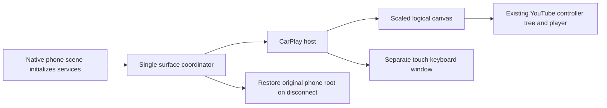

# How native YouTube reaches the CarPlay display

The core idea is to **reuse the already initialized application controller tree**. A second native root can have an empty navigation stack even when the tab bar renders, so constructing another root is insufficient.

## Ownership and lifecycle

`YCPSurface` owns one initialized root and one active car host. A placeholder temporarily occupies the source phone window. On disconnect the exact root returns, preserving its navigation state. A stale disconnect cannot release the active destination. The original phone scene manifest is retained; the package adds both a template route and a normal CarPlay-window route.

The implementation is app-local. It does not inject into SpringBoard, CarPlay services, or other applications, and it does not grant missing capabilities.

## Responsive layout

`YCPScaledContentView` computes scale from the actual safe viewport. The logical canvas aims for at least 1024×600 points on smaller displays, then scales uniformly. UIKit transforms maintain touch-coordinate conversion. Large displays need no enlargement. Geometry setters run only when values change, avoiding repeated work during playback updates.

The window background extends edge to edge; interactive content uses the safe-area guide so controls avoid the system sidebar. Wide watch layout is chosen from logical dimensions, with video/details on the left and the native queue/recommendations on the right. Tall displays keep the native stacked layout.

## Scoped native hooks

- **Browse:** positively recognized Home/Browse/Subscriptions sections may receive grid-column overrides. Search, watch, playlist, queue, metadata, and unknown contexts keep native measurements.
- **Search:** the presented search viewport accounts for the system sidebar and content scale.
- **Header:** browse-specific safe-area correction removes a cached phone inset. Observing feed scroll movement drives the native header collapse/reveal methods without replacing the scroll delegate.
- **Watch:** native layout/orientation flags are derived from actual content geometry. Native split-metadata measurement is retained. The first below-player section receives clearance from the scrubber edge.
- **Mini-player:** native output frames are clamped to content bounds, preserve 16:9, and reserve tab-bar space.
- **Input:** a separate window places the SwiftUI keyboard above native search modals. Changes are forwarded through native text-input APIs.

The keyboard supports English/Arabic, symbols, shift, deletion, preview, and submission. Its implementation is self-contained in this repository.

## Playback compatibility

The working package keeps YouTube's player. Only bundle version metadata is overridden: actual 21.42.4 reports 21.45.4. This is a device-observed compatibility workaround, not proof of a general solution to server-side playback rejection. It is reversible through the packaging tools.

The original ad coordinator is not restored over YouMod's hooks. An earlier attempt introduced ads without fixing playback and was removed. The external TV-client request patch is excluded. Error instrumentation records domain/code and numeric status identifiers, without logging media URLs or credentials.

## Source boundaries

`CarPlay/` is the integration. `vendor/YouMod/` is attributed upstream tweak source. The YouTube executable and optional input dependencies remain external binaries. Their implementation is not the integration's source and is not covered by the integration's GPL grant.
